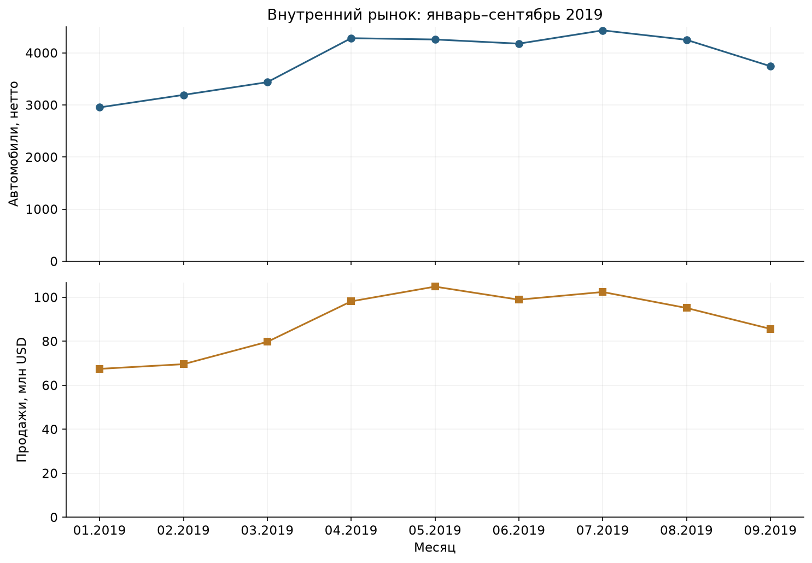
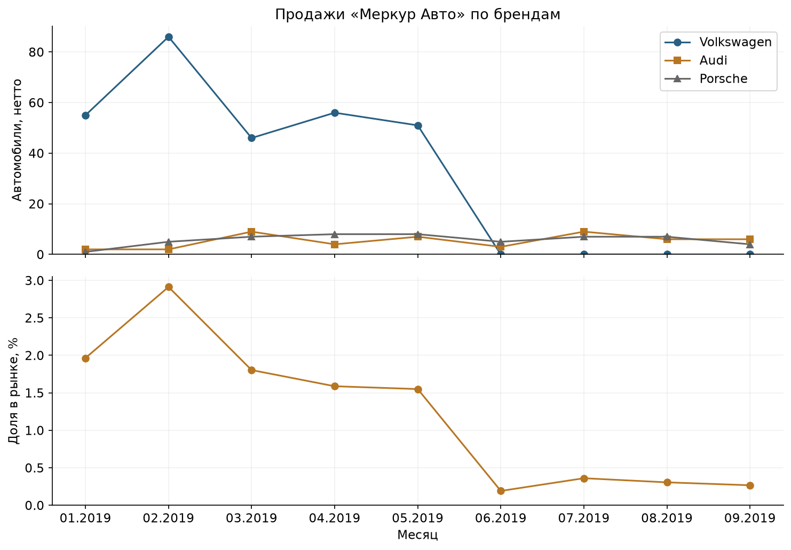

# Предподготовка и анализ продаж автомобилей в Казахстане

Курсовой проект • январь–сентябрь 2019 года

### Введение и актуальность

В работе исследованы данные о продажах автомобилей в Казахстане за девять месяцев 2019 года. Анализ выполнен для руководства автоцентра «Меркур Авто», которому необходимо оценить своё положение на рынке и определить направления дальнейшего развития. Подготовлены очищенный CSV, самостоятельный скрипт обработки и четыре выполненные тетради с расчётами, графиками и пояснениями.

Задача актуальна, поскольку операционные данные содержат неявные варианты названий, пропуски, смещённые значения и повторяющиеся строки. Без предварительной проверки эти ошибки искажают объёмы продаж, рыночные доли и сравнение среднего чека. Исследование показывает также, почему изменение структуры учёта нельзя автоматически считать изменением эффективности бизнеса.

### Цели работы

Техническая цель — получить датасет, пригодный для анализа и загрузки в BI, и автоматизировать его подготовку. Аналитическая цель — описать структуру и динамику рынка, рассчитать показатели «Меркур Авто», сопоставить их с рынком и сформулировать рекомендации, подтверждённые данными.

### Источник и определения показателей

Использован предоставленный файл autokz2019.csv: 39 966 строк и 25 столбцов. Оригинал сохранён без изменений. Денежные значения представлены в USD. Одна строка может включать несколько автомобилей, поэтому продажи рассчитываются суммированием количества, а не подсчётом строк. Основное сравнение относится к внутреннему рынку: записи с регионом «Экспорт» выделены отдельно.

Продажи нетто включают возвраты со знаком минус. Средняя стоимость проданного автомобиля рассчитывается как сумма положительных продаж, делённая на число положительно проданных автомобилей. Это показатель на автомобиль, а не точный средний чек заказа: идентификатора заказа нет. Доля компании в объёме или деньгах использует соответствующий итог рынка в знаменателе. В разрезе бренда, региона или сегмента знаменателем служит объём этой группы.

Основной результат: после очистки «Меркур Авто» представляет 394 автомобиля и 15.12 млн USD внутреннего рынка. Однако исчезновение его записей Volkswagen после мая требует проверки учёта до выводов о снижении эффективности.

## Очистка и контроль качества

CSV прочитан с разделителем «;» и десятичной запятой. Проверены размер, типы, пропуски и периоды. Полностью пустых строк не оказалось. Удалено 18 698 полных повторов сверх первого экземпляра по всем исходным полям. Проверка выполнена до удаления столбцов, чтобы различия в исходных записях не были ошибочно приняты за дублирование.

Удалены семь полей: дилерский центр, форма расчёта, старый сегмент, дополнительная сегментация Eng, локализация производства, тип клиента и модификация. Поля «Сегмент ЕПР» буквально в файле нет; «Сегментация Eng» выбрана как ближайший аналог по назначению. Поля сегментации и класса 2013 сохранены. Модификация использована для проверки гибридов до удаления. Итоговые имена столбцов переведены на английский.

Названия 19 стран преобразованы в ALPHA-3; топливо — в F, D, E и HYB. Объединены варианты компаний, включая Mercur Auto и Mercur Autos. Привод приведён к 4WD, FWD, RWD и 2WD; последнее обозначение не позволяет определить ведущую ось. Трансмиссии сведены к автомату и механике. В автомат включены вариаторы, роботы и электрические редукторы в соответствии с двухкатегорийной схемой задания.

В 27 строках Renault восстановлены смещённые объём двигателя и тип коробки; утраченное топливо оставлено неизвестным. Исправлены 25 значений Chevrolet Niva на 1.7 л по согласующимся строкам модели и последовательному характеру ошибки. У электрического Jaguar I-Pace значение «400 л.с.» не интерпретировалось как литры: объём ДВС принят равным нулю. Аналогично обработаны значения ёмкости батареи электробуса. Суффиксы L, MPI, GDI и другие технические обозначения удалены из числового объёма.

Регионы и области приведены к регистру с заглавной буквой каждого слова. Дата продажи построена как последний календарный день месяца, включая 28 февраля. Год и месяц удалены; дата имеет тип datetime, требуемые категориальные поля — category. Числовые поля проверены, неразрывные пробелы в годе выпуска удалены.

Шесть строк без количества и с нулевой суммой помещены в отдельный карантин. Один возврат, партия 100 Skoda Octavia и партия 115 Lada 4x4 сохранены. Неизвестные характеристики не заполнены средними значениями. После удаления лишних полей совпадающие аналитические группы агрегированы с сохранением сумм и числа исходных записей. Получено 16 141 строка, представляющая 21 262 пригодные записи и 35 165 автомобилей нетто вместе с экспортом. Повторное чтение CSV и контроль типов, дат и денежных равенств выполнены.

## Результаты анализа рынка

Внутренний рынок очищенной выборки составляет 34 725 автомобилей нетто и 801.70 млн USD. Экспорт — 440 автомобилей и 13.48 млн USD — исключён только из внутренних рыночных сравнений, но сохранён в итоговом датасете. Средняя стоимость положительно проданного автомобиля равна 23 087 USD.

Лидируют Lada — 11 085 автомобилей, Hyundai — 4 987 и Toyota — 3 636; вместе они составляют около 56.8% объёма. Крупнейшие рынки по городам — Алматы, 7 682 автомобиля, и Нур-Султан, 5 682. Легковые автомобили дают 15 008 единиц, внедорожники — 14 047. В топливной структуре преобладает бензин, но 2 985 автомобилей имеют неизвестный тип топлива; они включены в знаменатель.

Месячный объём изменяется от 2 953 автомобилей в январе до максимума 4 432 в июле; в сентябре продано 3 744. Рост сентября к январю составляет 26.8%, но девять месяцев одного года не позволяют доказать сезонность или оценить годовой рост. Распределения цены, объёма двигателя и года выпуска, модельный состав, коробки передач и связь цены с объёмом подробно представлены в тетради 03. Распределения взвешены по числу автомобилей, возвраты в них исключены.

Рисунок 1. Внутренний рынок после очистки; источник — предоставленный CSV.

## Положение Меркур Авто

На «Меркур Авто» приходится 394 автомобиля и 15.12 млн USD: 1.135% внутреннего объёма и 1.886% суммы продаж. Средняя стоимость автомобиля — 38 380 USD, примерно на 66.2% выше рынка. При рыночных ценах и структуре брендов самого автоцентра ожидаемая средняя цена составляет 37 810 USD. Следовательно, значительная часть различия связана с портфелем; высокий чек не доказывает высокую прибыльность.

Продано 294 Volkswagen, 48 Audi и 52 Porsche. Доля компании в Volkswagen составляет 28.05%; все наблюдаемые Audi и Porsche принадлежат «Меркур Авто», что характеризует охват файла, а не доказывает монополию. Алматы обеспечивает 251 автомобиль, или 63.7% объёма компании. Локальная доля в Алматы — 3.27%, в Нур-Султане — 0.90%. В легковом сегменте доля составляет 1.56%, во внедорожниках — 1.03%.

С июня в исходных данных нет Volkswagen у «Меркур Авто», тогда как Volkswagen Group Rus продолжает продажи бренда. Среднемесячный объём компании снижается с 69.4 до 11.75 автомобиля, но Audi и Porsche вместе — с 10.6 до 11.75. Разрыв сосредоточен в Volkswagen и сохраняется без удаления дубликатов. Причина не установлена; изменение атрибуции остаётся гипотезой.

Рисунок 2. Изменение брендов и доли «Меркур Авто» в очищенном источнике.

## Рекомендации и ограничения

Сильная сторона наблюдаемого позиционирования — присутствие в трёх брендах, включая дорогие Audi и Porsche, и доля денежного оборота выше доли автомобилей. Уязвимость — концентрация: Volkswagen составляет 74.6% объёма, Алматы — 63.7%. Оценку результатов следует вести отдельно по брендам и периодам, поскольку после мая сопоставимость ряда нарушена.

Первое действие — сверить продажи Volkswagen за июнь–сентябрь с дилерской системой и уточнить правила отнесения записей к компаниям. Без этого нельзя уверенно трактовать снижение как провал продаж. Второе — проверить наличие автомобилей, цены и конверсию по моделям Volkswagen относительно сопоставимых продавцов. Модельный рейтинг в тетрадях помогает выбрать объекты проверки, но не заменяет данные о запасах и заявках.

В Алматы разумно проверить удержание клиентов и работу с существующей базой. Нур-Султан представляет крупный рынок при меньшем присутствии компании; это основание изучить спрос и экономику расширения, а не готовое обоснование открытия точки. Для Audi и Porsche нужны отдельные показатели маржи, оборачиваемости и конверсии. Прибыль, рентабельность и эффективность персонала по имеющимся полям рассчитать невозможно.

Ключевое ограничение — отсутствие идентификатора сделки. Без удаления повторов внутренний объём равен 51 955 автомобилей, а доля «Меркур Авто» — 1.251% против 1.135% после очистки. Поэтому абсолютные объёмы нельзя выдавать за подтверждённую официальную статистику. Повторы удалены согласно заданию, а чувствительность решения раскрыта. Данные не подтверждают покупателя крупных партий или причины изменений спроса.

Часть технических характеристик остаётся неизвестной; значения показаны отдельной категорией в разрезах и исключены только из соответствующего числового распределения. Подозрительные 2.5 л у автобусов Daewoo оставлены без неподтверждённой замены. Исторические географические названия не обновлялись. CSV не сохраняет типы category и datetime: они восстанавливаются функцией read_clean().

### Код и воспроизводимость

Ссылка на репозиторий проекта приведена ниже. Основной скрипт очистки — clean_data.py. Тетради 01–04 содержат выполненные ячейки и результаты; README описывает запуск, а REQUIREMENTS_CHECKLIST связывает требования задания с файлами. Для просмотра кода и тетрадей откройте репозиторий. В распакованном комплекте эти материалы доступны как отдельные файлы.

[Код и тетради проекта на GitHub](https://github.com/kolyas18-gif/kazakhstan-auto-sales-2019-UlyanovNN--26-555)

Исходный источник задания: https://code.s3.yandex.net/high-education_higher-data-analytics/autokz2019.csv . Для расчётов использована локальная копия пользователя; контрольная сумма сохранена в data/cleaning_summary.json.
